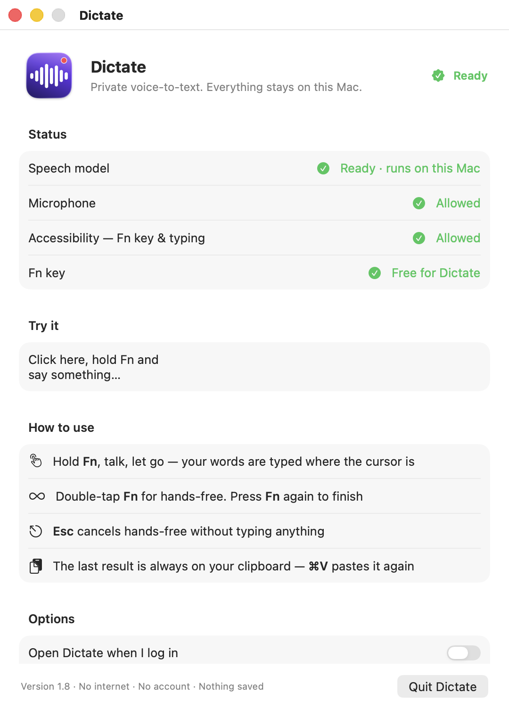

<p align="center">
  
</p>

<h1 align="center">Dictate</h1>

<p align="center">
  Hold Fn, talk, and let go. Your words show up wherever you're typing.
</p>

<p align="center">
  <a href="https://github.com/Wave-Drop-Maps/Dictate/actions/workflows/build.yml"></a>
  
  
  
  
  <a href="LICENSE"></a>
</p>

<p align="center">
  
  &nbsp;&nbsp;
  
</p>

Dictate is a free, open-source dictation app for the Mac. It runs entirely on your computer, so there's no
account, no subscription and no word limit, and nothing you say is ever sent anywhere.

## Why Dictate?

Most dictation apps send your voice to their servers to turn it into text. Many also collect the text around
your cursor for context, charge a monthly fee, and limit how much you can say on the free plan.

Dictate does the work on your Mac instead. It uses NVIDIA's Parakeet speech model running on the Neural Engine,
which makes it fast and accurate, and it keeps working with your Wi-Fi switched off.

| | Typical cloud dictation app | Dictate |
|---|---|---|
| Where your voice goes | Their servers | Nowhere. It stays on your Mac. |
| Account | Required | Not needed |
| Price | Monthly subscription | Free |
| Word limit | Weekly cap on free plans | None |
| Works offline | No | Yes |
| 30 seconds of speech | Depends on your connection | About a quarter of a second |

## Features

- **Hold Fn to talk.** Let go and the text is typed into whatever app you're using.
- **Double-tap Fn for hands-free.** Talk for as long as you like, then press Fn once to finish. Press Esc to cancel.
- **Every result is copied too.** If the text doesn't land where you expected, just press ⌘V.
- **It tells you when there's nowhere to type.** If no text box is selected, you'll see a small notice with a
  Copy button rather than your words quietly disappearing. This works in regular apps and in your browser.
- **Smart spacing.** Dictate adds a space when you start talking straight after a word.
- **You can always tell it's listening.** A small waveform appears at the bottom of the screen and the menu bar
  shows a timer while you talk.
- **It stays out of your way.** Your usual Fn shortcuts, like Fn with an arrow key, still work, and accidental
  taps are ignored.
- **It's lightweight.** It's about 1,600 lines of Swift, and when idle it uses no CPU and around 30 MB of memory.

<p align="center">
  
</p>

## What you need

- A Mac with Apple Silicon (M1 or newer) running macOS 14 Sonoma or later
- Apple's Command Line Tools, which you can install with `xcode-select --install`

## Installing

```bash
git clone https://github.com/Wave-Drop-Maps/Dictate.git
cd Dictate
./build-app.sh
```

The first build downloads [FluidAudio](https://github.com/FluidInference/FluidAudio), so give it a few minutes.
When it's done, Dictate is in your Applications folder and you can open it like any other app.

### The first time you open it

1. **Download the speech model.** Click **Download (470 MB)** in Dictate's window. This is the only time
   Dictate uses the internet.
2. **Allow the microphone** when macOS asks.
3. **Turn on Accessibility.** Go to System Settings → Privacy & Security → Accessibility and switch on Dictate.
   It needs this to notice the Fn key and type for you.
4. **Free up the Fn key.** Go to System Settings → Keyboard and set **Press 🌐 key to** to **Do Nothing**.
   Otherwise Fn will also open the emoji picker.
5. **Optional:** switch on **Open Dictate when I log in**.

Each step gets a green tick in Dictate's window once it's done. Closing the window doesn't quit the app, so Fn
keeps working. To quit, use the menu bar icon, the Dock, or ⌘Q.

## Privacy

- After the one-time model download, Dictate never connects to the internet. There are no analytics, no crash
  reports and no account.
- Your audio is kept in memory only while you're talking, then thrown away.
- Transcripts are never saved to disk. The Recent list in Settings is cleared when you quit.
- To decide whether it can paste, Dictate asks macOS what kind of control is selected, such as a text box, a list
  or a button. It never reads what's inside. The only text it looks at is the single character before your
  cursor, so it knows whether to add a space.
- There's an optional diagnostic log, which is off by default. It records key presses and app states, never
  audio or text.

## How it works

The code is split into a handful of small files:

| What it does | File |
|---|---|
| Handles the Fn key and delivers the text | [`AppController.swift`](Sources/Dictate/AppController.swift) |
| Records from the microphone | [`Recorder.swift`](Sources/Dictate/Recorder.swift) |
| Turns speech into text with Parakeet | [`Transcriber.swift`](Sources/Dictate/Transcriber.swift) |
| Finds the text box, adds spacing and pastes | [`TextInsertion.swift`](Sources/Dictate/TextInsertion.swift) |
| Draws the waveform pill and notices | [`Overlay.swift`](Sources/Dictate/Overlay.swift) |
| Shows the status in the menu bar | [`MenuBarIndicator.swift`](Sources/Dictate/MenuBarIndicator.swift) |
| Settings window and preferences | [`Settings.swift`](Sources/Dictate/Settings.swift) |

You can also run `Dictate --transcribe recording.wav` to print a transcript of an audio file, which is handy for
testing the model. The icon is drawn by [`scripts/make-icon.swift`](scripts/make-icon.swift).

## Good to know

- **Signing.** `build-app.sh` signs the app for your own Mac with a fixed identifier, so macOS remembers your
  permissions when you rebuild. If you want to share a ready-made copy with other people, sign it with an Apple
  Developer ID and notarise it.
- **Languages.** Parakeet v3 understands 25 European languages, including English.

## Credits

- Speech model: [NVIDIA Parakeet TDT 0.6B v3](https://huggingface.co/nvidia/parakeet-tdt-0.6b-v3) (CC-BY-4.0),
  converted to Core ML by [FluidInference](https://huggingface.co/FluidInference/parakeet-tdt-0.6b-v3-coreml).
- On-device inference: [FluidAudio](https://github.com/FluidInference/FluidAudio) (Apache-2.0).
- Sound: "drop_003" from [Kenney's Interface Sounds](https://kenney.nl/assets/interface-sounds) (CC0).
- The icon was made for this project.

## License

Dictate is released under the [MIT License](LICENSE).
