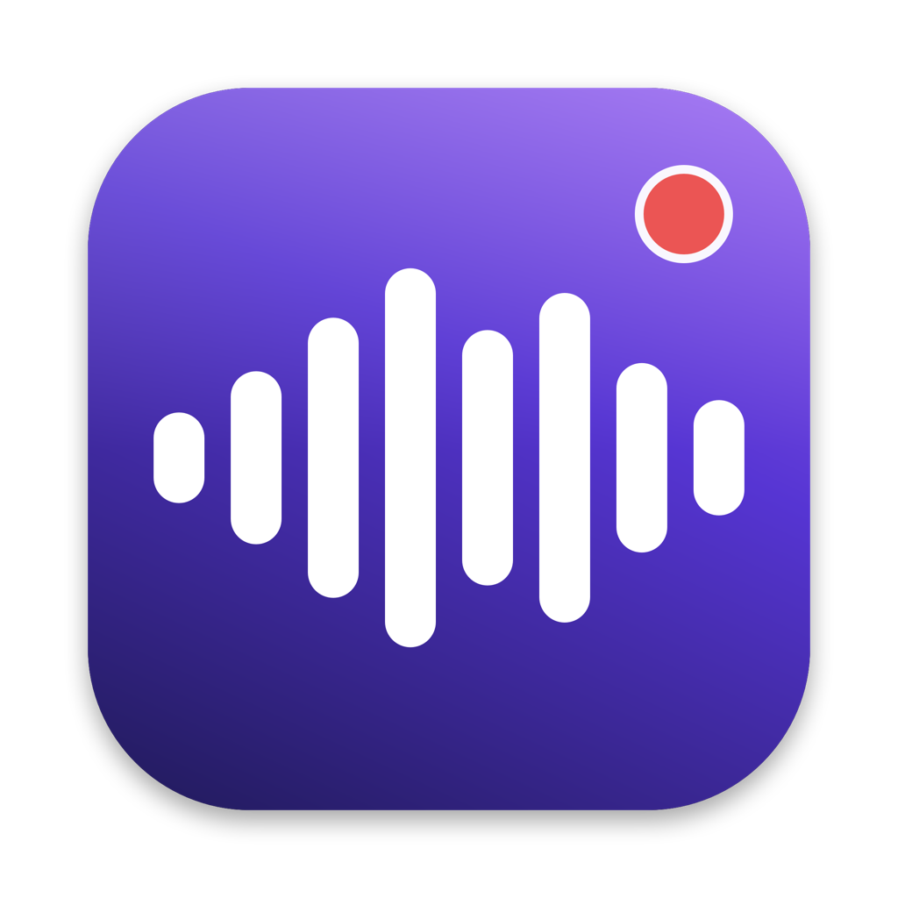

<p align="center">
  
</p>

<h1 align="center">Dictate</h1>

<p align="center">
  <b>Hold Fn, talk, let go. Your words appear wherever you're typing.</b><br>
  Private, offline voice-to-text for macOS — no account, no subscription, no word limits.
</p>

<p align="center">
  <a href="https://github.com/Wave-Drop-Maps/dictate/actions/workflows/build.yml"></a>
  
  
  
  
  <a href="LICENSE"></a>
</p>

<p align="center">
  
  &nbsp;&nbsp;
  
</p>

---

## Why

Cloud dictation apps send your voice — and often the text around your cursor — to their servers, charge monthly,
and cap how much you can say. Dictate runs NVIDIA's **Parakeet** speech model on your Mac's **Neural Engine**
instead. It's fast, accurate, and works with the Wi-Fi off.

| | Cloud dictation apps | **Dictate** |
|---|---|---|
| Where your voice goes | Their servers | **Nowhere — stays on your Mac** |
| Account / subscription | Required | **None** |
| Word limits | Weekly caps on free plans | **Unlimited** |
| Works offline | No | **Yes** |
| Speed (30 s of speech) | Network round trip | **~0.25 s on an M-series Mac** |

## Features

- **Hold Fn to talk** — release and the text is typed into the app you're in.
- **Double-tap Fn for hands-free** — talk as long as you like, press Fn again to finish. Esc cancels.
- **Always on your clipboard** — every result is copied too, so ⌘V works if anything goes wrong.
- **Knows when there's nowhere to type** — no text box selected? You get a small notice with a Copy button
  instead of text vanishing. Works in native apps and in browsers.
- **Smart spacing** — dictating straight after a word adds the space for you.
- **Live feedback** — a small waveform pill at the bottom of the screen and a `Listening 0:07` timer in the menu bar.
- **Stays out of the way** — Fn shortcuts (Fn+arrows etc.) keep working and quick stray taps are ignored.
- **Lightweight** — about 1,600 lines of Swift, 0% CPU and ~30 MB of memory while idle.

<p align="center">
  
</p>

## Requirements

- macOS 14 Sonoma or later on Apple Silicon (M1 or newer)
- Xcode Command Line Tools — `xcode-select --install`

## Install

```bash
git clone https://github.com/Wave-Drop-Maps/dictate.git
cd dictate
./build-app.sh
```

The first build fetches [FluidAudio](https://github.com/FluidInference/FluidAudio) and takes a few minutes.
The script installs **Dictate.app** into `/Applications`; open it from there or with Spotlight.

### First launch

1. **Speech model** — click **Download (470 MB)** in Dictate's window. This is the only time Dictate uses the
   internet.
2. **Microphone** — click Allow.
3. **Accessibility** — System Settings → Privacy & Security → Accessibility → switch on **Dictate**. This is how
   it notices the Fn key and types for you.
4. **Fn key** — System Settings → Keyboard → set **Press 🌐 key to** → **Do Nothing**, so Fn doesn't also open
   the emoji picker.
5. Optional: switch on **Open Dictate when I log in**.

Dictate's window shows a green tick next to each of these once it's set up. Closing the window keeps Dictate
running; quit it from the menu bar, the Dock, or ⌘Q.

## Privacy

- No network access after the one-time model download. No analytics, no crash reporting, no account.
- Audio is held in memory only while you're dictating, then discarded.
- Transcripts are never written to disk. The "Recent" list in Settings lives in memory and is gone when you quit.
- To decide whether to paste, Dictate asks macOS what *kind* of control has focus (text box, list, button) — never
  its contents. The only text it reads is the one character before your cursor, for smart spacing.
- The optional diagnostic log (off by default) records key events and state changes, never audio or text.

## How it works

| Piece | File |
|---|---|
| Fn key state machine and delivering text | [`AppController.swift`](Sources/Dictate/AppController.swift) |
| Microphone → 16 kHz mono | [`Recorder.swift`](Sources/Dictate/Recorder.swift) |
| Speech-to-text with Parakeet via FluidAudio | [`Transcriber.swift`](Sources/Dictate/Transcriber.swift) |
| Text-box detection, smart spacing, paste | [`TextInsertion.swift`](Sources/Dictate/TextInsertion.swift) |
| Waveform pill and notices | [`Overlay.swift`](Sources/Dictate/Overlay.swift) |
| Menu bar status | [`MenuBarIndicator.swift`](Sources/Dictate/MenuBarIndicator.swift) |
| Settings window and preferences | [`Settings.swift`](Sources/Dictate/Settings.swift) |

`Dictate --transcribe recording.wav` prints a transcript, which is handy for checking the model.
The icon and sounds are generated by [`scripts/`](scripts).

## Notes

- **Signing.** `build-app.sh` signs ad-hoc with a fixed identifier so macOS keeps your permissions across
  rebuilds. That suits building it yourself; a distributed binary should be signed with a Developer ID and
  notarised.
- **Languages.** Parakeet v3 supports 25 European languages, including English.

## Credits

- Speech model: [NVIDIA Parakeet TDT 0.6B v3](https://huggingface.co/nvidia/parakeet-tdt-0.6b-v3) (CC-BY-4.0),
  Core ML conversion by [FluidInference](https://huggingface.co/FluidInference/parakeet-tdt-0.6b-v3-coreml).
- On-device inference: [FluidAudio](https://github.com/FluidInference/FluidAudio) (Apache-2.0).
- The icon and interface sounds are original to this project.

## License

[MIT](LICENSE)
